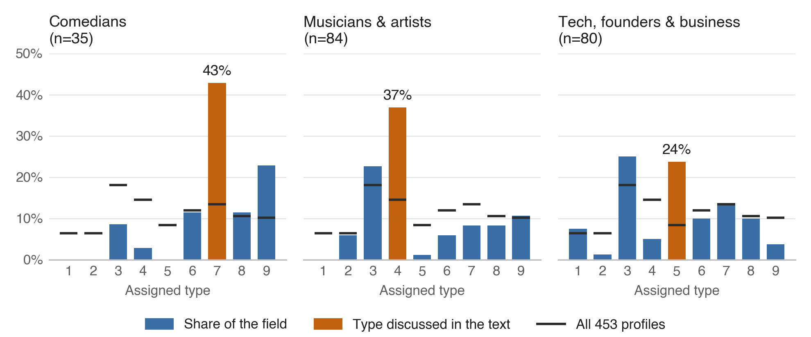

<!-- docs/outreach/enneagram-monthly/what-famous-peoples-types-can-and-cant-tell-us.md -->
# What Famous People's Types Can and Can't Tell Us

_Patterns in 453 public-figure typings, and the limits that come with them_

By DJ Wayne

Do certain personality types gravitate toward certain professions?

It seems like they would. Each type has its own habits of attention, and habits of attention turn into skills. Someone who is always scanning for the next possibility gets quick at connecting ideas. Someone who is always reading the room gets good at reading people. Over the years, those skills can carry a person into the work that rewards them.

I write Enneagram analyses of public figures at 9takes, 453 of them as of October 19, 2026, and the professions do cluster. Some of the patterns are what you'd expect, and some aren't. The people who follow a field's pattern are interesting, and so are the people in the same field who break it. Let me start with the clearest one.

## Why so many comedians are Sevens

Picture a comedian a minute into a set. Why does this person tell jokes for a living? Where did that skill come from, and how did it get so sharp? There are a few ways it could develop, but the obvious answer is a quick wit, and quick wit is the signature of the Enneagram Seven. Sevens think in possibilities. They jump from one idea to the next, and they're usually the most fun person in the room.

Fifteen of the 35 comedians I've typed are Sevens, among them Robin Williams, Eddie Murphy, Kevin Hart, Conan O'Brien and Jack Black. That's 43 percent, in a collection where Sevens make up about 13 percent overall.

The motive under the wit matters more than the wit. Sevens move away from pain. When something painful, uncomfortable or just boring shows up, a joke turns it into something lighter and more fun to live with. You can see it in comedians who use humor to cover what hurts. The joke works on the audience, and it works on the comedian too.

## The Nines on the same stage

Nines are the second-largest group: 8 of the 35, including Dave Chappelle, Adam Sandler, Steve Carell and Nate Bargatze. Their comedy comes from a different place.

Nines belong to the Enneagram's body center, the center organized around anger, and they tend to keep that anger out of sight. A Nine who sees something that should make them furious will often make a joke about it instead. The joke is genuinely funny, but there's a tinge of anger underneath it, a passive-aggressive edge in making light of something serious. A Seven jokes to get away from pain. A Nine jokes instead of picking a fight.

Then there are the comedians who fit neither pattern. Four are typed Eight, including Amy Poehler and Joe Rogan. Four are Sixes, including Bill Burr and Stephen Colbert. Three are Threes, including Tina Fey and Mindy Kaling. Nobody is typed One, Two or Five. What does an Eight bring to a stage built for Sevens? The exceptions are as much a part of the pattern as the rule.

## Beyond comedy

Comedy is one profession. The same kind of clustering shows up in others, and Figure 1 puts comedians next to two of them.

_Figure 1. Share of profiles assigned each Enneagram type in three fields, compared with all 453 profiles (black marks). Editorial typings of selected public figures from the public record, not test results. Fields overlap. Source: 9takes.com, snapshot of October 19, 2026._

### Musicians and Fours

Thirty-one of 84 musicians and artists are typed Four: 37 percent, against 15 percent overall. Threes are second with 19. One musician is typed Five, and none is typed One.

### Founders and Fives

This pattern depends on how you count. Across all 80 profiles in the tech, founder and business category, Threes are the most common type with 20, and Fives are right behind with 19. The Fives are the bigger departure: 24 percent of the category against 8 percent of the collection. When I narrowed the category on October 7 to the 46 people who actually built or ran a company, Fives led 14 to 11. Most of the Threes I left out were celebrities with a brand on the side.

None of these gaps looks like chance. For each of the three, the odds of a gap that large turning up at random from the collection's own mix are below one in ten thousand. Chance is the easy explanation to rule out, though. The harder ones come from how the collection was built.

## What I counted

Each profile is a written analysis of one person, built from the public record: long-form interviews, podcast transcripts, speeches, the person's own writing, and accounts from people who know them. None of these typings comes from a test. Every type in this article is an editorial reading from the outside.

The process asks for more than a verdict. Before a profile commits to a type, it has to name the strongest alternative, the observation that separates the two, and what the chosen type still fails to explain. When the record can't support a call, the profile waits. Or it's published as an "open case," which names the evidence that would settle it. AI tools help me gather sources and review drafts. The final typing is my judgment.

Subjects are chosen mostly by public interest: people in the news, people readers ask about, people whose type is already being argued over online. That pulls the collection toward performers, founders and internet personalities. Fields come from each profile's category tags, and they overlap, so a comedian who also acts counts in both comedy and film. The full counts for all seven fields are in Table 1.

## What the numbers can't separate

Each pattern has at least four explanations, and this data can't tell them apart.

The first is who becomes famous. Comedy may attract Sevens. It may also reward people of any type who learn to perform quickness, deflection and play. A collection of famous comedians can't distinguish a field that draws Sevens from a field that trains everyone to sound like one.

The second is who I chose to profile. I write about people the internet is curious about, and when a field's most-discussed figures share a style, the collection inherits it. The founders in the collection lean heavily toward technology, and seven of those 46 company leaders are best known for AI companies. Take those seven out and Fives and Threes tie at ten each. Fives stay at roughly three times their usual share, but the lead disappears.

Third, the record itself is uneven. Musicians talk about their inner lives for a living. Their interviews and lyrics are full of longing, identity and feeling misunderstood, which is the vocabulary of the Four. A typist reading that record will find Four material whether or not the motive underneath is a Four's. Founders give long interviews about systems and problems, and that reads as Five. So do the 26 authors and thinkers, whose public record is mostly their ideas: they skew Five by about the same margin the musicians skew Four. A public record is the part of a person their work puts on display.

The fourth is me. I know the stereotypes as well as anyone, and when evidence is ambiguous, an expectation that comedians are Sevens can tip the call. Naming the strongest alternative before committing is meant to slow that down. It can't remove it. One editorial process, applied 453 times, can repeat its own blind spot 453 times.

For the same reasons, the collection says little about people in general. Its most common type is Three, at 18 percent. Large online test samples look different. A 2022 Truity report on about 54,000 test-takers put Eight first at 15 percent, and enneagram-personality.com's distribution of 200,000 test-takers puts Nine first at 16.5 percent, with Threes at 10 percent. Those numbers come from a different instrument, self-scored tests, so the comparison can't settle which is right. It does show that a collection of famous people is a sample of fame.

## Where careful typists disagree

Uncertainty doesn't stay in the aggregate. It shows up one person at a time.

On January 1, 2026, the Typology podcast aired an episode with Andrew Greer about Jimmy Carter, describing Carter as "a quintessential Enneagram One." I type Carter as a Two with a One wing. Both readings start from the same record: the Sunday school classes he kept teaching in Plains, the houses he built by hand into his nineties, a moral seriousness he never set down. The disagreement is over motive. A One serves to set the world right. A Two serves to be needed. My profile of Carter concedes that a careful typist could land on 1w2 instead of 2w1. Neither reading is careless. The evidence sits on a border, and the call turns on which motive you think the behavior serves.

The same border trouble shows up in my own work. Since January, I've changed the assigned type of 11 people in the collection after a closer look at the evidence. Several are the classic lookalikes. David Goggins moved from Six to Eight, once the question came down to whether his relentlessness runs on anxiety or on anger. His profile now says plainly that "this site once argued the opposite." Tim Ferriss moved from Five to One. Doja Cat moved from Seven to Nine.

Eleven of 453 is about 2 percent in under ten months. It only counts the changes I caught and recorded, so the real number is higher.

Anyone who has typed themselves knows the experience behind those numbers. Two or three types fit. The tests disagree by a question or two. The deciding evidence is a motive nobody can observe directly. Typing famous strangers from the outside doesn't escape that problem. It compounds it.

## How to read a type statistic

None of this makes the patterns useless. It changes what they're good for. A few habits help, whether the numbers come from 9takes or anywhere else:

- Keep the denominator next to the percentage. "43 percent of 35 comedians" is a much smaller claim than "43 percent of comedians."
- Ask who chose the sample and how each person was typed. A self-scored test, an interview with a teacher and an outside read of the public record measure different things.
- Treat a field pattern as a question about the field. If comedians come out as Sevens, ask what comedy rewards and what it trains people to show.
- Keep every individual typing open to revision, including the confident ones.

The pattern I trust most in this collection cuts across the types. The more a field's public record is a performance, the more lopsided its typing. Comedians perform play, musicians perform feeling, authors publish their thinking, and each field leans hard toward the type that matches what it performs. That could mean those fields attract those types. It could also mean the work makes people easier to read and easier to misread. A collection like this one can pose that question clearly. Answering it would take people nobody chose for their fame, typed in a way that doesn't depend on what they show an audience.

_Table 1. Number of profiles assigned each type (columns 1 to 9), by field. Editorial typings, 9takes.com, snapshot of October 19, 2026. Fields come from category tags and overlap, so field totals add up to more than the number of profiles._

| Field                             |       n |      1 |      2 |      3 |      4 |      5 |      6 |      7 |      8 |      9 |
| :-------------------------------- | ------: | -----: | -----: | -----: | -----: | -----: | -----: | -----: | -----: | -----: |
| **All profiles**                  | **453** | **29** | **29** | **82** | **66** | **38** | **54** | **61** | **48** | **46** |
| Film & TV                         |     177 |     11 |     15 |     27 |     23 |      5 |     31 |     23 |     16 |     26 |
| Creators & internet personalities |     101 |      4 |      5 |     24 |     12 |      5 |      8 |     23 |     13 |      7 |
| Musicians & artists               |      84 |      0 |      5 |     19 |     31 |      1 |      5 |      7 |      7 |      9 |
| Tech, founders & business         |      80 |      6 |      1 |     20 |      4 |     19 |      8 |     11 |      8 |      3 |
| Politics & public figures         |      62 |      8 |     10 |     10 |      7 |      7 |      6 |      2 |      7 |      5 |
| Comedians                         |      35 |      0 |      0 |      3 |      1 |      0 |      4 |     15 |      4 |      8 |
| Authors & thinkers                |      26 |      5 |      1 |      0 |      4 |      8 |      3 |      1 |      4 |      0 |

## Sources

- 9takes corpus statistics, snapshot of October 19, 2026. [https://9takes.com/corpus-stats](https://9takes.com/corpus-stats)
- 9takes, "What Enneagram Type Are Most CEOs?" (October 7, 2026). [https://9takes.com/enneagram-corner/what-enneagram-type-are-most-ceos](https://9takes.com/enneagram-corner/what-enneagram-type-are-most-ceos)
- Typology podcast, "Jimmy Carter, the Enneagram, and the life that comes after striving, with Andrew Greer" (January 1, 2026). [https://www.typologypodcast.com/podcast/2026/andrewgreer](https://www.typologypodcast.com/podcast/2026/andrewgreer)
- 9takes, Jimmy Carter profile. [https://9takes.com/personality-analysis/jimmy-carter](https://9takes.com/personality-analysis/jimmy-carter)
- 9takes, David Goggins profile. [https://9takes.com/personality-analysis/david-goggins](https://9takes.com/personality-analysis/david-goggins)
- Truity, "What Is the Most Common Enneagram Type?" (October 26, 2022). [https://www.truity.com/blog/what-most-common-enneagram-type](https://www.truity.com/blog/what-most-common-enneagram-type)
- Enneagram Personality, type distribution report (200,000 test-takers, updated April 7, 2026). [https://enneagram-personality.com/en/reports/distribution](https://enneagram-personality.com/en/reports/distribution)

## About the author

DJ Wayne founded 9takes (9takes.com), where people answer a question anonymously before they see how all nine types answered it. He has written Enneagram analyses of more than 450 public figures and lives in Maryland.
